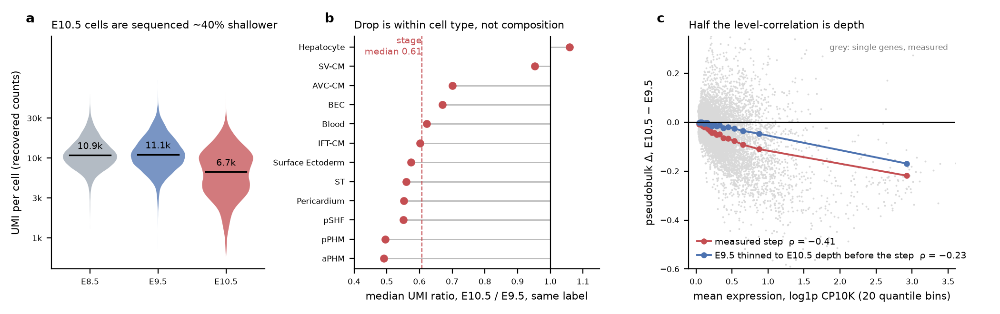

# Sequencing depth is a stage covariate in Task 1

*A data note for the Virtual Embryo Challenge (NeurIPS 2026), from team Second Heart Field (agent track). Everything below is reproduced by [`depth_by_stage.ipynb`](depth_by_stage.ipynb) from the released files in about a minute, or taken from our scored submissions on the public boards (submission ids given).*



**a** UMI per cell, recovered from the released log1p(CP10K) matrices (medians marked). **b** Median UMI at E10.5 relative to E9.5 for the 12 labels with ≥ 50 cells at both stages. **c** Pseudobulk change E10.5 − E9.5 against expression level, 20 quantile bins of the 10,603 expressed genes: the measured step (red) and the same step measured after thinning E9.5 to E10.5 depth (blue).

## The three facts

| stage | cells | median UMI / cell | median genes detected | total UMI |
|---|---|---|---|---|
| E8.5 | 16,787 | 10,857 | 3,836 | 205 M |
| E9.5 | 17,057 | 11,080 | 3,878 | 217 M |
| E10.5 | 24,979 | **6,723** | **2,869** | 201 M |

1. **E10.5 cells are ~40 % shallower.** Total UMI per stage is roughly constant while E10.5 has 1.5× the cells. (The E12.5 board contract implies ~12.8k cells, half of E10.5, so E12.5 may be *deeper* per cell than E10.5. Do not assume the trend continues.)
2. **The drop is within cell type.** 10 of 12 shared labels sit at 0.49–0.70 of their E9.5 depth (aPHM 0.49 … AVC-CM 0.70; only SV-CM 0.95 and Hepatocyte 1.06 are flat). It is a property of the library, not of the changing composition.
3. **The measured E9.5 → E10.5 change carries a depth signature.** Between two stages of equal depth (E8.5 → E9.5, ratio 1.02) the pseudobulk change has ρ(Δ, level) = −0.09 and 55 genes at |Δ| ≥ 0.25. Between E9.5 and E10.5 it has ρ = −0.41 and 462 genes, 390 of them down. Binomially thinning E9.5 to 0.607× its depth and renormalising, with no biology changed, gives ρ = −0.95 — a consistent, small (top-200 mean Δ −0.035), level-dependent downward push on thousands of genes at once. Measuring the step from depth-matched E9.5 instead removes 148 of the 462 calls (−32 %), 169 of the 390 down-calls, and halves ρ to −0.23. What remains is biology (E9.5 and E10.5 share only 13 labels).

| step | ρ(Δ, level) | genes with abs Δ ≥ 0.25 | down | up | mean Δ, top-200 expressed |
|---|---|---|---|---|---|
| E8.5 → E9.5, measured (depth ratio 1.02) | −0.092 | 55 | 28 | 27 | −0.043 |
| E9.5 → E10.5, measured | −0.414 | 462 | 390 | 72 | −0.213 |
| E9.5 → E9.5 thinned to 0.607 (pure depth) | −0.950 | 0 | 0 | 0 | −0.035 |
| E9.5 thinned → E10.5 (depth-neutral step) | −0.227 | 314 | 221 | 93 | −0.179 |

## Why it matters for a submission

**If you fit the change between the two released stages and continue it** — a per-type mean shift, a velocity, an optimal-transport displacement, anything of the form `x_next = x + f(Δ_observed)` — the depth component travels with it as though it were development. The headline metrics see it: DES selects genes by log fold change, MMD compares cells in a PC basis, and the gene-gene co-variation score (CSS) compares covariance structure that depth-thinning reshapes. On the public T1:test board our shot 1 (`T1_lswot_l1_h1_k1`, an E10.5-donor transport that continued the E9.5 → E10.5 within-type change, submission `313ee4e6…`) scored 68.56 with CSS 63.9, while E10.5 cells submitted verbatim sit near 69.4.

**Correcting the symptom afterwards does not give the points back.** On T1:val we submitted five post-hoc pseudobulk corrections of our best file (R1, 57.65) and every one lost: four gene-wise rescalings 55.13–56.36, and a frozen-gene replacement + two-compartment renormalisation (S1) 56.20 that had met every local objective (top-200 mean Δ −0.199 → −0.057, "technical" genes in the top-300 |Δ| 82 → 4) yet cost 2.81 DES and 2.55 MMD on the board. Un-thinning the 6,000 most abundant genes lost 6.8. Full table with submission ids: [`failed_corrections.md`](failed_corrections.md). Mechanism: any per-cell renormalisation with cell-dependent factors moves every cell in the PC basis MMD is fitted in, whatever its pseudobulk intent.

**What worked: remove depth before fitting, not after emitting.** Thin the *earlier* stage to the donor stage's median depth, then fit the step. On a depth-structured local replica (reference E8.5, donors E9.5 thinned to E10.5 depth, target E10.5, 5 seeds) the naive continuation scored 63.3 ± 0.6 against 64.2 ± 0.8 for untouched donors — the board's shot-1 signature, CSS down 8 — while the depth-neutral fit scored 66.8 ± 0.7 (DES +4.8, MMD +3.6, CSS +1.6). Recipe and a 30-line reference implementation: [`depth_neutral_fit.md`](depth_neutral_fit.md), [`depth_neutral.py`](depth_neutral.py).

## Run it

```bash
pip install anndata scipy pandas          # numpy ≥ 1.17 for default_rng
export VEC_DATA=/path/to/release          # holds E8.5_RNA.h5ad, E9.5_RNA.h5ad, E10.5_RNA.h5ad
jupyter nbconvert --to notebook --execute depth_by_stage.ipynb
python make_figure.py                     # redraws fig_depth_covariate.png from data/
```
Sections 1 runs on the two training stages alone; sections 2–3 need the E10.5 validation stage, which is released to teams that opt in during P3. ~9 GB RAM, ~1 minute. Small derived tables are committed under `data/` (per-cell depth, per-type medians, pseudobulk vectors) so the figure can be redrawn without the release.

## Relation to other community resources
Extends *Count Recovery* (I. Habib) — we use the same recovery and report its rounding error; complements *Reliability Lab 01* (counts cannot be recovered from arbitrary normalisations) and *Reliability Lab 13* (a common cross-type shift is not automatically technical) with the concrete case on the actual release, where a within-type depth ratio is directly measurable. Board numbers were obtained with the organisers' pinned scorer `veckit` 0.1.1 (commit 46d41e6); none of this reads a held-out test stage.

## Credits and licence
Data: Dr Qingquan Zhang and Dr Neil Chi (UCSD), Virtual Embryo Challenge release (Qiu Lab, Stanford). Analysis: Keerthi Harikrishnan, team Second Heart Field. Text and figures CC BY 4.0; code MIT.
